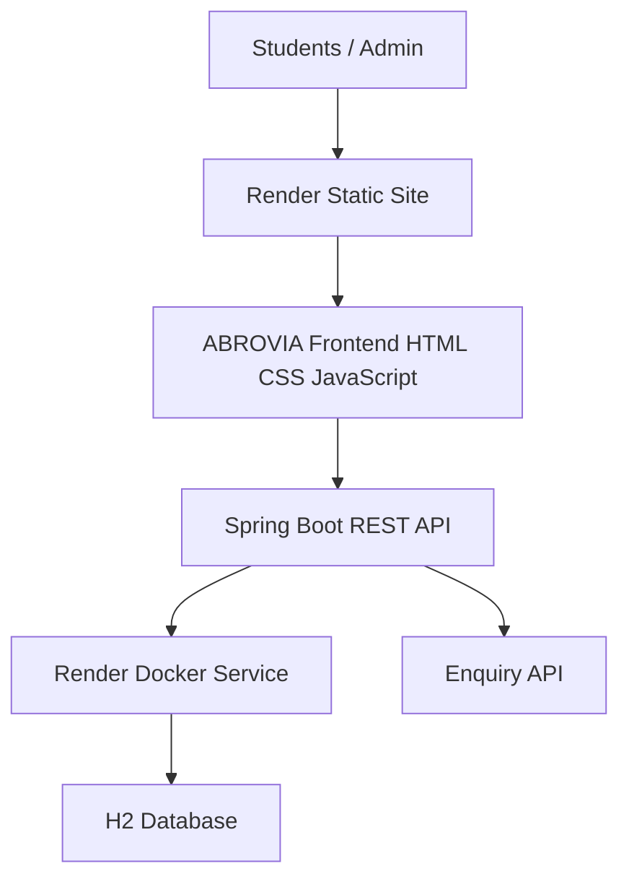

# ABROVIA – Cloud Architecture

## 1. Project Overview

ABROVIA is a Study Abroad Consultancy Platform that helps students explore study destinations, view sample university information, and submit enquiries.

The application uses cloud hosting so that users can access the website through the internet.

## 2. Cloud Service Provider

**Provider:** Render

**Service Model:** Platform as a Service (PaaS)

Render provides hosting and deployment services without requiring us to manage physical servers.

## 3. Cloud Architecture

## 4. Technologies Used

| Component | Technology |
|---|---|
| Frontend | HTML, CSS, JavaScript |
| Backend | Java Spring Boot |
| API | REST API |
| Containerisation | Docker |
| Cloud Hosting | Render |
| Database | H2 |
| Version Control | GitHub |

## 5. Deployment Details

Frontend URL:
https://abrovia-website.onrender.com

Backend URL:
https://abrovia-study-abroad-platform.onrender.com

Backend Health Check:
https://abrovia-study-abroad-platform.onrender.com/api/hello

The frontend is deployed as a Render Static Site.

The backend is deployed as a Docker-based service on Render.

## 6. Database

The application currently uses an H2 in-memory database.

It stores student enquiry information while the backend application is running.

**Limitation:** In-memory data can be lost when the backend restarts. A persistent managed database is planned for a future version.

## 7. Cloud Storage

The current application does not yet use a separate object storage service.

A cloud object storage service can be added for student documents, uploaded files, and backups.

This is a planned improvement, not an implemented feature.

## 8. Cloud Security

- The website uses HTTPS through Render.
- The backend API is accessible through HTTPS.
- Input validation is implemented for enquiry data.
- Production credentials and API secrets should be stored using environment variables.
- Admin authentication is currently a demonstration login and must be strengthened before production use.
- Persistent database storage should use the provider's encryption and access-control features.

## 9. Scalability and Reliability

Future scalability improvements include:

- Increasing backend resources when traffic grows.
- Using load balancing and multiple application instances.
- Moving to a persistent managed database.
- Scheduling regular database backups.
- Monitoring application availability and response times.

The current free hosting setup does not guarantee automatic scaling or persistent database backups.

## 10. Monitoring

The Render dashboard provides deployment status and application logs.

The backend health endpoint can be used to check whether the application is responding:

https://abrovia-study-abroad-platform.onrender.com/api/hello

## 11. Conclusion

ABROVIA has been deployed successfully using Render and Docker.

The frontend and backend are publicly accessible. Persistent database storage, object storage, stronger authentication, and advanced monitoring are identified as future improvements.
